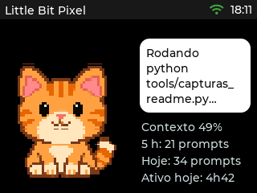
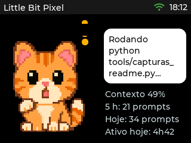
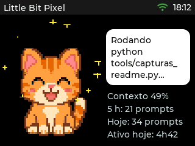
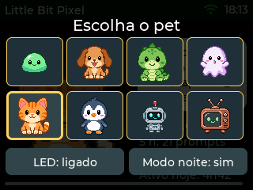
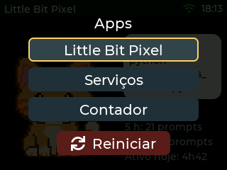
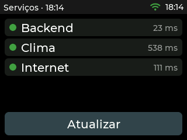
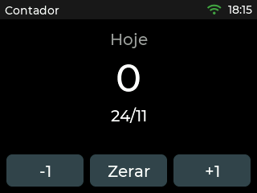
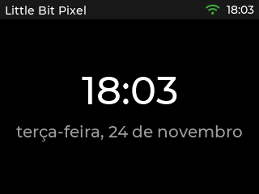
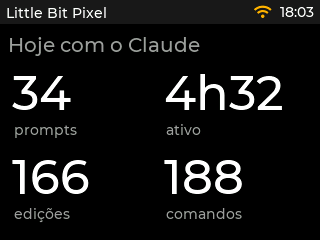
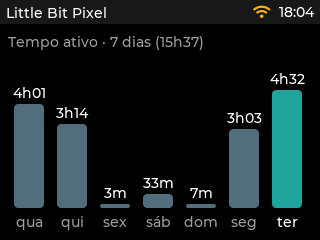

# Little Bit Pixel

**Um bichinho em pixel art que mora numa telinha ESP32 e reage ao que o Claude Code está fazendo no seu PC.**
Ele dorme quando você não está usando, se concentra quando o agente trabalha, pula e chama quando precisa de você,
e comemora quando a tarefa termina. Enquanto dorme, a tela vira um relógio com clima e o resumo do seu dia.

E a mesma placa serve para outras ideias: o pet é só um dos **apps**. Troque de app com um toque e a tela vira um
monitor de serviços, um contador com botões ou o que você programar em poucas linhas de Python.


| Trabalhando… | Precisa de você! | Terminou |
|---|---|---|
|  |  |  |

---

## O que ele faz

- **Reage ao Claude Code em tempo real** (menos de 1 s), via hooks: dormindo → trabalhando → *precisa de você*
  (pergunta, plano para aprovar, permissão) → terminou. O balão mostra o que está acontecendo ("Editando ui.cpp",
  "Rodando pio…") e, embaixo, o uso: contexto da sessão, prompts nas últimas 5 h e no dia, tempo ativo.
- **8 pets em pixel art**: Gato, Blob, Robô, Fantasminha, Cachorro, TV retrô, Pinguim e Dino. Cada um pisca, respira
  dormindo e tem quadros de alerta, alegria e concentração; gato, cachorro e dino abanam o rabo.
  Troque arrastando o dedo ou segurando o dedo no pet.
- **Crie o seu pet**: gere a arte no ChatGPT (receita pronta em [pets/PROMPTS.md](pets/PROMPTS.md)), salve a imagem
  na pasta `pets/` e em 20 segundos ele aparece na placa, sem regravar nada. O backend limpa e converte a imagem.
- **Carrossel quando ele dorme**: relógio e data, clima da sua cidade, resumo do dia com o Claude e gráfico de tempo
  ativo dos últimos 7 dias.
- **LED traseiro** ilumina a parede conforme o humor (âmbar trabalhando, vermelho piscando quando precisa de você,
  verde ao terminar) e **modo noite** por horário.
- **Apps**: toque no título da barra para trocar entre o pet, o **Monitor** de serviços e o **Contador**. O mesmo
  menu tem o botão **Reiniciar**.
- **Privacidade**: tudo roda na sua rede. Do PC só sai para a placa o nome do evento, da ferramenta, do arquivo e a
  1ª linha do comando; nunca o prompt nem o conteúdo dos arquivos.

| Seletor de pets | Menu de apps | Monitor | Contador |
|---|---|---|---|
|  |  |  |  |

| Relógio (pet dormindo) | Hoje com o Claude | Últimos 7 dias |
|---|---|---|
|  |  |  |

---

## Como funciona

```
 Claude Code ──hooks──▶ backend (FastAPI, no seu PC) ──Wi-Fi──▶ placa ESP32 (LVGL)
                         ▲ pets/*.webp   ▲ clima          long-poll: a tela muda em < 1 s
                         └ converte      └ Open-Meteo     toques voltam como "ações"
```

A placa é "burra": desenha telas a partir de um JSON pequeno e anima o pet localmente. Toda a lógica (estado do
pet, uso do Claude, clima, conversão dos desenhos, apps) fica no **backend**, que roda no mesmo PC do Claude Code
(ou num Raspberry Pi na rede). Nada passa pela internet além da consulta do clima.

---

## Você vai precisar

- **Placa CYD ESP32-2432S028** ("Cheap Yellow Display"), versão de **2 portas USB** com tela **ST7789** 320×240 e
  toque resistivo. A variante com ILI9341 também funciona trocando um flag (ver [docs/HARDWARE.md](docs/HARDWARE.md)).
- Cabo USB e um PC com **Windows** (o backend é Python e roda em qualquer sistema; os atalhos deste guia são de
  Windows).
- [Python 3.12+](https://www.python.org/) e [PlatformIO](https://platformio.org/) (`pip install platformio`).
- [Claude Code](https://claude.com/claude-code) instalado (o pet reage a ele; os outros apps funcionam sem).
- Rede Wi-Fi **2,4 GHz**.

---

## Instalação

### 1. Backend (no PC)

```powershell
git clone https://github.com/macckk/ESP_little_bit.git
cd ESP_little_bit\backend
python -m venv .venv
.\.venv\Scripts\pip install -r requirements.txt
copy .env.example .env
```

Edite `backend\.env` e troque os dois tokens por valores aleatórios (gere com
`python -c "import secrets; print(secrets.token_urlsafe(24))"`). Coloque também a sua cidade para o clima:

```ini
HOOK_TOKEN=<aleatório>
DEVICE_TOKEN=<outro aleatório>
WEATHER_CITY=Campinas
WEATHER_STATE=São Paulo
```

Teste rodando com console (Ctrl+C para parar):

```powershell
.\.venv\Scripts\python.exe serve.py
```

Abra http://127.0.0.1:8000/health: deve responder `"ok": true`. O `serve.py` fica de guarda: se o servidor cair, ele
sobe de novo sozinho. Na primeira vez ele converte os pets (~1 min);
depois sobe em segundos.

**Iniciar com o Windows** (sem janela): crie um atalho na pasta Inicializar, ajustando o caminho:

```powershell
$repo = "C:\caminho\para\ESP_little_bit"
$s = (New-Object -ComObject WScript.Shell).CreateShortcut("$env:APPDATA\Microsoft\Windows\Start Menu\Programs\Startup\CYD backend.lnk")
$s.TargetPath = "$repo\backend\.venv\Scripts\pythonw.exe"; $s.Arguments = "`"$repo\backend\serve.py`""; $s.WorkingDirectory = "$repo\backend"; $s.Save()
```

Libere a porta **8000** no firewall do Windows para a rede privada (a placa precisa alcançar o PC). Reserve um IP
fixo para o PC no roteador.

### 2. Firmware (na placa)

```powershell
cd ESP_little_bit
copy secrets.ini.example secrets.ini
```

Em `secrets.ini`, defina uma senha de OTA (atualização pela rede) e, depois de saber o IP da placa, o `ota_host`.
Ajuste a porta COM em `platformio.ini` (`upload_port`/`monitor_port`) e grave pelo USB:

```powershell
pio run -e cyd2usb -t upload
```

Opcional: `pio run -e hwtest -t upload` grava um teste de tela, toque (com calibração) e microSD. Os valores medidos
na placa de referência estão em [docs/HARDWARE.md](docs/HARDWARE.md).

### 3. Primeira inicialização

A placa abre uma rede Wi-Fi **`cyd-xxxx-setup`** e mostra a senha e um QR na tela.

1. Conecte o celular nessa rede. A página de configuração abre sozinha (ou acesse 192.168.4.1).
2. Em **Configure WiFi**: escolha sua rede 2,4 GHz, a senha, a **URL do backend** (`http://<IP do PC>:8000`) e o
   **token** (o `DEVICE_TOKEN` do `.env`). Salve.
3. A placa reinicia e mostra o andamento: Wi-Fi, o **IP** que recebeu e "Buscando dados no PC…"; depois, o pet.
   Se o PC estiver desligado, ela avisa e continua tentando sozinha.

Para recomeçar do zero: segure o botão **BOOT** por 5 segundos.

### 4. Ligar ao Claude Code

Acrescente os hooks em `~/.claude/settings.json` (todas as sessões), com o caminho do seu clone:

```json
{
  "hooks": {
    "SessionStart":     [{"hooks": [{"type": "command", "command": "python \"C:/caminho/ESP_little_bit/backend/hooks/claude_hook.py\"", "timeout": 5, "async": true}]}],
    "UserPromptSubmit": [{"hooks": [{"type": "command", "command": "python \"C:/caminho/ESP_little_bit/backend/hooks/claude_hook.py\"", "timeout": 5, "async": true}]}],
    "PreToolUse":       [{"matcher": "*", "hooks": [{"type": "command", "command": "python \"C:/caminho/ESP_little_bit/backend/hooks/claude_hook.py\"", "timeout": 5, "async": true}]}],
    "PostToolUse":      [{"matcher": "*", "hooks": [{"type": "command", "command": "python \"C:/caminho/ESP_little_bit/backend/hooks/claude_hook.py\"", "timeout": 5, "async": true}]}],
    "Notification":     [{"hooks": [{"type": "command", "command": "python \"C:/caminho/ESP_little_bit/backend/hooks/claude_hook.py\"", "timeout": 5, "async": true}]}],
    "Stop":             [{"hooks": [{"type": "command", "command": "python \"C:/caminho/ESP_little_bit/backend/hooks/claude_hook.py\"", "timeout": 5, "async": true}]}],
    "SessionEnd":       [{"hooks": [{"type": "command", "command": "python \"C:/caminho/ESP_little_bit/backend/hooks/claude_hook.py\"", "timeout": 5, "async": true}]}]
  }
}
```

Os hooks são assíncronos (não atrasam o Claude), leem o `HOOK_TOKEN` do `backend/.env` e saem em silêncio se o
backend estiver desligado. Opcional, só no Claude Code de terminal: a linha de status
`"statusLine": {"type": "command", "command": "python \"C:/caminho/ESP_little_bit/backend/hooks/statusline.py\""}`
faz a tela mostrar o **% do plano** (5 h e semana).

---

## Uso

| Na placa | O que faz |
|---|---|
| Arrastar o dedo para o lado sobre o pet | troca de pet |
| Segurar o dedo no pet | seletor de pets + botões de LED e modo noite |
| Toque rápido no pet | carinho (corações) |
| Toque no título da barra | menu de apps e botão **Reiniciar** |
| Toque com o pet dormindo (carrossel) | volta ao pet por 1 min |
| Segurar **BOOT** 5 s | apaga a configuração e volta ao portal Wi-Fi |

**Criar um pet:** siga [pets/PROMPTS.md](pets/PROMPTS.md). Em resumo: no ChatGPT, anexe o gato como referência,
gere o personagem, uma folha com *normal, piscando, dormindo* (`pets/<nome>_base.webp`) e outra com *alerta, feliz,
trabalhando* (`pets/<nome>_alerta.webp`). Para conferir antes:
`backend\.venv\Scripts\python tools\pet_convert.py <nome>` gera a prévia.

**Configurar os apps:** `backend/apps.json` define quais aparecem no menu, o app padrão, os serviços do Monitor e o
Contador. **Criar um app** é uma classe Python com `screen()` (a tela) e `action()` (os toques); exemplo pronto em
[docs/GUIA.md](docs/GUIA.md#criar-um-app-novo).

**Atualizar o firmware pela rede** (sem cabo, depois da primeira gravação):

```powershell
pio run -e cyd2usb_ota -t upload
```

---

## Estrutura

```
backend/            FastAPI: apps, estado do pet, uso do Claude, clima, conversor de pets
  app/apps/         os apps (pet, monitor, contador) e o contrato para criar novos
  hooks/            hooks do Claude Code e linha de status
  apps.json         apps no menu e configuração de cada um
src/app/            firmware: tela, layouts, pet, carrossel, rede, OTA, LED
include/            pinos, tela, calibração do toque, configuração da LVGL
pets/               os desenhos dos pets (+ PROMPTS.md com a receita do ChatGPT)
tools/              conversor/prévia de pets, captura de tela pelo serial, fontes, utilitários
docs/               GUIA.md (técnico), HARDWARE.md (placa medida), img/
```

## Documentação

- **[docs/GUIA.md](docs/GUIA.md)**: guia técnico completo (apps, protocolo, endpoints, conversão dos pets,
  partições, NVS, comandos do serial, problemas resolvidos).
- **[docs/HARDWARE.md](docs/HARDWARE.md)**: pinos, calibração do toque, tela, microSD, LED e o que não funciona na
  placa (o sensor de luz).
- **[pets/PROMPTS.md](pets/PROMPTS.md)**: como criar pets no ChatGPT.

## Créditos

Feito com [LVGL](https://lvgl.io/), [LovyanGFX](https://github.com/lovyan03/LovyanGFX),
[WiFiManager](https://github.com/tzapu/WiFiManager), [ArduinoJson](https://arduinojson.org/),
[FastAPI](https://fastapi.tiangolo.com/) e [Open-Meteo](https://open-meteo.com/). Fonte Montserrat e ícones
Font Awesome (via LVGL). Pets desenhados com ChatGPT e convertidos pelo próprio projeto. Desenvolvido com
[Claude Code](https://claude.com/claude-code).

## Licença

[MIT](LICENSE): use, modifique e distribua à vontade, mantendo o aviso de copyright. As bibliotecas usadas têm as
licenças delas (LVGL e LovyanGFX: MIT/BSD; fonte Montserrat: SIL OFL; ícones Font Awesome Free: CC BY 4.0, via LVGL).
